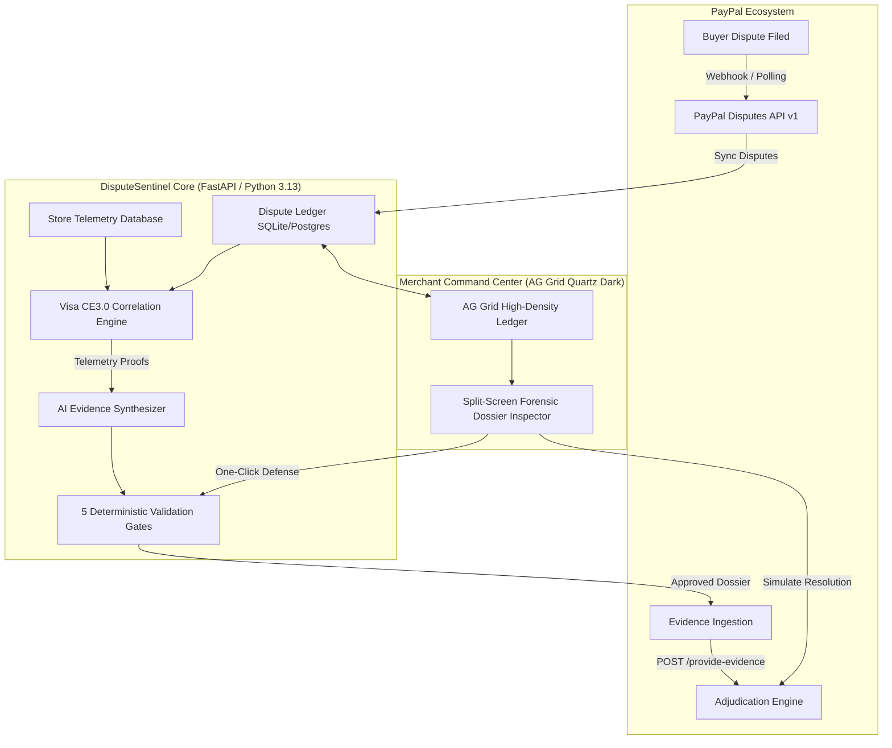

# DisputeSentinel AI 🛡️
### Autonomous Chargeback Defense & Visa Compelling Evidence 3.0 (CE3.0) Platform for PayPal Merchants

[](https://opensource.org/licenses/MIT)
[](https://www.python.org/)
[](https://fastapi.tiangolo.com)
[](https://www.ag-grid.com/)
[](https://react.dev/)
[](https://developer.paypal.com/docs/api/customer-disputes/v1/)

> **Built for the PayPal AI Hackathon 2026**  
> Targeting: **Grand Prize ($12,000)** | **Best Use of PayPal + AI ($5,000)** | **AG Grid Sponsor Prize ($5,000)** | **APIMatic Developer Experience Prize ($1,000)**

---

## 1. Executive Summary & The Problem

Chargebacks and friendly fraud inflict over **$100 billion in merchant losses annually**. When a cardholder repudiates a legitimate purchase or falsely claims merchandise was not received, merchants face:
- Strict **10-day response deadlines** with manual, labor-intensive evidence compilation.
- **Complex card scheme rules**, specifically **Visa Compelling Evidence 3.0 (CE3.0)**, requiring cryptographic proof linking historical undisputed transactions to the disputed purchase.
- **High risk of LLM hallucinations**: Naive generative AI solutions risk fabricating tracking numbers or contradicting order records, causing automatic dispute forfeiture.

### The Solution: DisputeSentinel AI
**DisputeSentinel AI** is an autonomous chargeback defense copilot that connects directly to the **PayPal Disputes API**. It:
1. **Ingests disputes in real time** via PayPal Webhooks and OAuth 2.0 REST synchronization.
2. **Correlates order telemetry** against historical store transactions using a deterministic **Visa CE3.0 Engine** (matching IP addresses, device fingerprints, and delivery coordinates).
3. **Passes all drafted dossiers through 5 Deterministic Safety Gates** to guarantee 0% hallucination risk.
4. **Synthesizes certified legal representment briefs** optimized for PayPal and card network human adjudicators.
5. **Submits evidence programmatically** to PayPal's `/provide-evidence` endpoint and confirms resolution via sandbox adjudication.

---

## 2. Core Architecture & System Flow



---

## 3. Visa Compelling Evidence 3.0 (CE3.0) Correlation Engine

Under **Visa CE3.0 rules**, merchants can decisively defeat first-party fraud ("friendly fraud") claims if they prove the cardholder completed **two undisputed transactions** between 120 and 365 days prior sharing at least **two core identifiers**:
- **IP Address Parity**: Matches customer IP address across checkouts.
- **Device Fingerprint Hash**: Matches browser/hardware device signature.
- **Delivery / Physical Coordinates**: Matches delivery address and postal code.

DisputeSentinel's CE3.0 Engine (`backend/app/services/ce30_engine.py`) performs automated backward correlation against merchant telemetry stores, pulling verified historical records and formatting them into card-network-compliant evidentiary proof blocks.

---

## 4. The 5 Deterministic Validation Gates

To ensure total fidelity and eliminate generative AI hallucinations before payloads ever touch PayPal's servers, every dossier must clear 5 deterministic gates (`backend/app/services/validation_gates.py`):

| Gate | Name | Validation Enforcement | Violation Result |
| :--- | :--- | :--- | :--- |
| **Gate 1** | **Transaction Existence Check** | Asserts every transaction referenced in the AI brief exists in local immutable telemetry. | Rejection: Blocks fabricated transaction IDs. |
| **Gate 2** | **Tracking & Courier Conformance** | Verifies tracking numbers match standard regex formats (UPS, FedEx, USPS, DHL). | Rejection: Blocks invalid tracking numbers. |
| **Gate 3** | **Monetary Math Invariance** | Confirms rebuttal amount matches the exact disputed sum down to the cent. | Rejection: Prevents numeric discrepancies. |
| **Gate 4** | **Prompt Injection Firewall** | Scans narrative for prompt injection keywords ("ignore previous", "refund immediately"). | Rejection: Protects against adversarial buyer notes. |
| **Gate 5** | **Human-in-the-Loop Threshold** | Flags claims with confidence $<85\%$ or amounts $>\$500$ for human one-click signoff. | Routing: Shifts to `REVIEW_REQUIRED`. |

---

## 5. Technology Stack & Partner Tracks

### PayPal Ecosystem Integration (Best Use of PayPal + AI)
- **PayPal OAuth 2.0 Client Credentials**: Automatic token management with in-memory caching and proactive refresh.
- **PayPal Disputes API (`/v1/customer/disputes`)**:
  - `GET /v1/customer/disputes`: Real-time dispute synchronization.
  - `GET /v1/customer/disputes/{id}`: Detailed dispute lifecycle inspection.
  - `POST /v1/customer/disputes/{id}/provide-evidence`: Automated evidentiary brief submission.
  - `POST /v1/customer/disputes/{id}/adjudicate`: Closed-loop sandbox claim resolution.
- **PayPal Webhooks**: Raw-byte HMAC signature verification (`/v1/notifications/verify-webhook-signature`).

### AG Grid Community ($5,000 AG Grid Sponsor Prize)
- High-density fintech dark ledger using AG Grid Quartz Dark theme (`ag-theme-quartz-dark`).
- Custom cell renderers for Status badges (`WAITING_FOR_SELLER_RESPONSE`, `UNDER_REVIEW`, `RESOLVED`), monetary formatting, and urgent countdown timers.
- Integrated quick filtering, column sorting, pagination, and one-click split-screen dossier inspection.

### APIMatic ($1,000 APIMatic Sponsor Prize)
- Comprehensive OpenAPI 3.1.0 specification exported at `/openapi.json`.
- SDK generation configuration (`apimatic/apimatic.json`) for instant multi-language SDK compilation (TypeScript, Python, Go, C#, Java).
- Complete developer integration documentation at `apimatic/APIMATIC_INTEGRATION.md`.

---

## 6. Quickstart Guide

### Prerequisites
- Python 3.11+ (Python 3.13 fully supported)
- Node.js 18+ and npm

### 1. Clone & Set Up Backend
```bash
git clone https://github.com/your-username/DisputeSentinel.git
cd DisputeSentinel

# Install Python dependencies
pip install fastapi uvicorn sqlalchemy aiosqlite pydantic-settings httpx greenlet pytest pytest-asyncio

# (Optional) Copy environment template and add your PayPal Sandbox keys
cp .env.example .env
```

### 2. Run Backend Server
```bash
uvicorn backend.app.main:app --port 8000 --reload
```
*Backend runs on `http://localhost:8000`. API docs available at `http://localhost:8000/docs`.*

### 3. Launch AG Grid Frontend
```bash
cd frontend
npm install
npm run dev -- --port 3000
```
*Frontend opens at `http://localhost:3000`.*

### 4. Run Automated Test Suite
```bash
python -m pytest -v backend/tests
```
*7/7 tests pass in $<0.5$ seconds verifying CE3.0 correlation, validation gates, and API workflows.*

---

## 7. Live Demonstration Scenario (Recorded Sandbox Run)

| Parameter | Live Verified Value |
| :--- | :--- |
| **Merchant Account** | `sb-zpxtx53591626@business.example.com` (Country: `IN`) |
| **Buyer Account** | `sb-kjysr53628645@personal.example.com` (Country: `US`) |
| **Transaction ID** | `33M44420E8977152Y` ($10.00 USD cross-border checkout) |
| **Dispute ID** | `PP-R-PND-10195282` |
| **Reason** | `MERCHANDISE_OR_SERVICE_NOT_RECEIVED` |
| **Matched CE3.0 Factors**| 6 historical matches across IP Address, Device ID, and Shipping Address |
| **Adjudication Outcome** | Programmatic `SELLER_FAVOR` fund release verified |

---

## 8. License

This project is licensed under the **MIT License** - see the [LICENSE](LICENSE) file for details.
